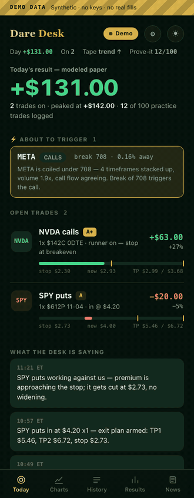
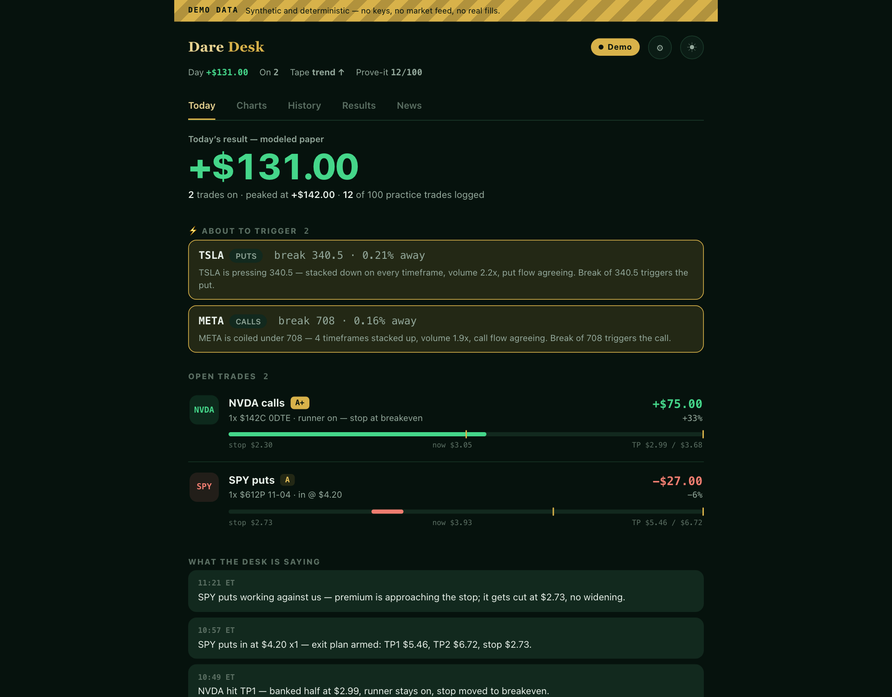
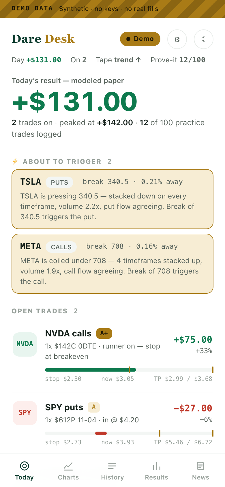
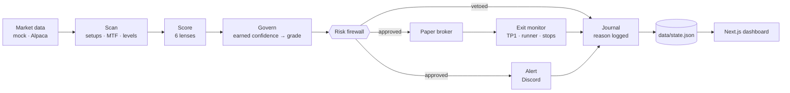
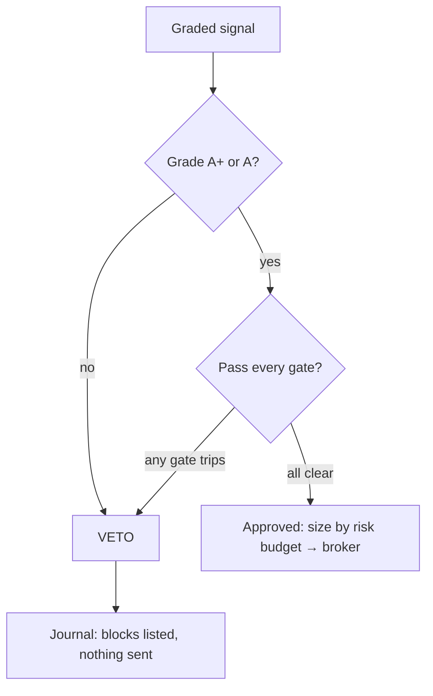

<p align="center"></p>

<p align="center">
  
  
  
</p>

> **Not financial advice.** DARE Desk is research and education software. It runs in **paper / demo mode by default**;
> live trading is off, and the only broker that works is a simulated one. Every fill is a modeled estimate, not live
> execution. The demo dashboard and the offline backtest use **synthetic data** — nothing here is evidence of a profitable edge.

## TL;DR

- A TypeScript engine that scans a liquid options universe, grades each setup (A+ to D), and emits signals with a full exit plan (TP1, TP2, stop, time stop).
- An **independent risk firewall** sits between the grade and the broker and can veto any signal, with the reason logged.
- **ARMED** pre-trigger alerts warn you before a strong setup breaks, so you are positioned instead of chasing.
- A replay backtester pushes historical bars through the same live pipeline with no lookahead.
- A mobile-first Next.js dashboard. It runs end to end with **no API keys** (heuristic scoring, mock or synthetic data).

<p align="center"></p>

<table>
  <tr>
    <td></td>
    <td width="260"></td>
  </tr>
</table>
<sub>Screenshots and GIF are captured from demo mode (deterministic synthetic data, labeled DEMO DATA on screen).</sub>

## Architecture



Providers (data, news, options, broker) are interfaces with mock and real implementations. See [ARCHITECTURE.md](ARCHITECTURE.md) for the component map.

## How the risk firewall vetoes a signal

The governor decides how good a setup is. The firewall (`src/engine/firewall.ts`) decides whether the account is allowed to take it. It is deterministic, runs after scoring, and a veto is final. Every rule that trips is recorded on the signal, and the dashboard lists vetoed A and A+ setups with their first reason.



Gates it checks today: no clear stop · spread too wide · theta budget · 0DTE outside the gamma window · reward/risk below the minimum · extended names below A+ · correlation heat · chase guard · per-name cooldown · lunch-chop suppression · event blackout · max trades per day · daily-loss and weekly breakers · loss-streak cooldown · max open positions · aggregate open-risk cap · profit lock. Thresholds come from `.env` (see `.env.example`).

## Run it locally (demo mode, no keys)

```bash
npm install && npm --prefix dashboard install
npm test                      # 129 tests, offline
npm run dashboard:demo        # builds, then serves http://localhost:3007 with synthetic data
```

Demo mode is also what you get when `data/state.json` does not exist yet. You can force it with `DARE_DESK_DEMO=1` or by opening `/?demo=1`.
`?tick=N` pins one frame of the scripted scenario (an ARMED alert appears at tick 2, a signal fires at tick 4) and `?poll=1500` speeds the loop up.

Engine and backtest (also keyless):

```bash
npm run go                    # continuous scanner, writes data/state.json (RUN_OFFHOURS=true to test after hours)
npm run backtest              # replay a synthetic 20-session tape through the live pipeline (~1 min)
npm run demo                  # one-shot walkthrough: idea → score → firewall → alert → paper fill → journal
```

> The offline backtest runs on a **synthetic** price tape. It shows the harness works end to end; its R-multiples say nothing about real markets.
> Set Alpaca keys to replay real history, and treat any result as a hypothesis until the 100-trade prove-it gate is met on real data.

## Dashboard notes

- Five tabs: Today, Charts, History, Results, News. Light and dark themes.
- **Haptics:** short vibration on a new ARMED alert or fired signal and on key toggles (Android Chromium via `navigator.vibrate`). It is feature-detected and a silent no-op on iOS and desktop. Toggle it in Settings; it defaults to off when the device asks for reduced motion.
- Animations respect `prefers-reduced-motion`.

## Design principles

- **Explainable.** Every signal carries the reasons it fired and, if vetoed, the rules that blocked it.
- **Discipline over volume.** It is built to pass on marginal setups.
- **Prove-it gated.** No performance claim until 100 validated paper trades with positive expectancy and no losing regime bucket.
- **Modeled honestly.** Fills include spread, slippage, commission and theta, and are always labeled as estimates.
- **Forkable.** Small typed modules; swap a provider without touching decision logic.

## Layout

```
src/
  scan/  scoring/  engine/  context/  data/  options/  news/
  discord/  backtest/  journal/  demo/     # demo/seed.ts = deterministic dashboard demo state
dashboard/                                  # Next.js dashboard (Today / Charts / History / Results / News)
```

## License and use

Provided as-is for research and education. You are responsible for your own trading decisions and for the terms of any data or broker provider you connect.
